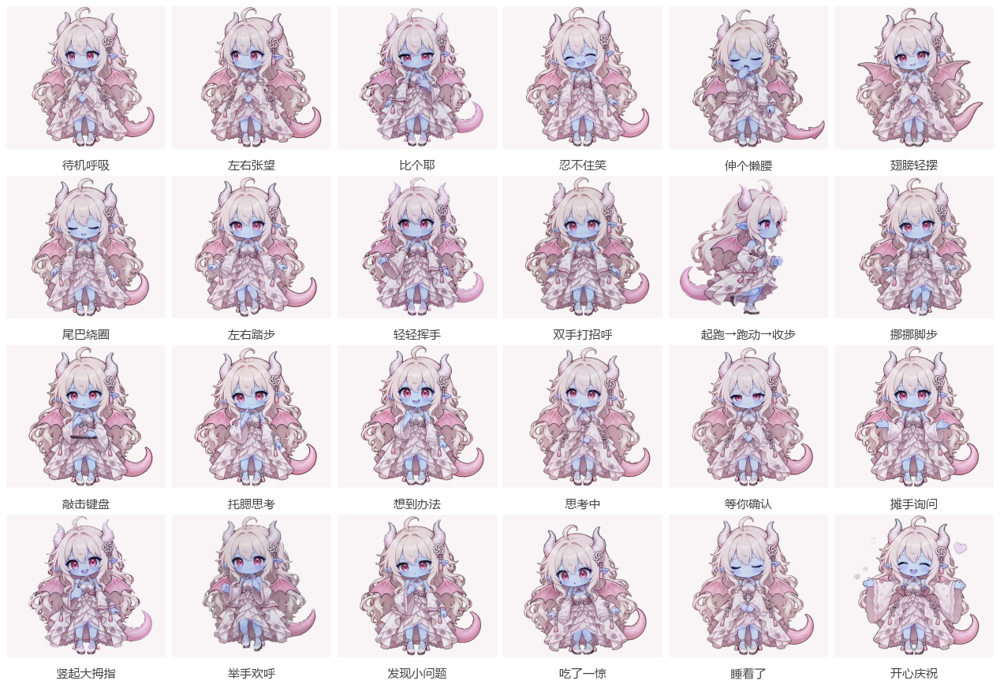

# 小龙娘 🐉

<p align="center">
  
  
  
  
  
  
</p>

<p align="center">
  
</p>

<p align="center">
  <b>一只住在 Windows 桌面上的白发小龙少女桌宠。</b><br>
  透明置顶、拖动投掷、自动漫游、右键点播 87 段动作，还能通过 Codex hooks 显示「工作中 / 等你确认 / 完成 / 出错」和本轮 Token 用量。
</p>

<p align="center">
  <sub>形象立绘由 Codex 生成 · 动作动画由豆包 AI 生成绿幕原片，再本地抠像成透明 WebM</sub>
</p>

---

## 📖 目录

- [这是什么](#-这是什么)
- [效果预览](#-效果预览)
- [安装](#-安装)
- [使用指南](#-使用指南)
- [动作库](#-动作库)
- [连接 Codex](#-连接-codex)
- [打包便携版](#-打包便携版)
- [动画素材管线](#-动画素材管线)
- [设置与数据](#-设置与数据)
- [卸载](#-卸载)
- [常见问题](#-常见问题)
- [从源码开发](#-从源码开发)
- [许可与致谢](#-许可与致谢)

## ✨ 这是什么

一个主进程 1200 行、渲染进程 700 行的 Electron 小应用：一个无边框、置顶、点击穿透的透明窗口，里面用两个 `<video>` 交叉淡入播放 VP9 Alpha WebM，所以角色的动作是**真视频**而不是帧序列图。

三件事让它和普通桌宠不一样：

1. **动作是一整套视频素材。** 87 段 640×576 透明视频，覆盖待机小动作、打招呼、工作、等待、完成、出错、睡觉、思考和一段 10 秒的完整跑动。全部由 AI 生成绿幕原片后本地抠像得到，抠像参数、编码链和质检报告都在仓库里。
2. **它知道 Codex 在干什么。** 通过 Codex hooks 接收提交、等待确认、完成、中断事件，自动切到对应动作；本轮结束后再读本机会话记录，用气泡报出这一轮花了多少 Token。
3. **窗口是真的「物理」的。** 弹簧跟手拖拽、松手按轨迹估速抛掷、屏幕边缘反弹、地面摩擦减速，参数都能在设置面板里调。

## 🖼️ 效果预览

<p align="center">
  
</p>

<p align="center">
  <sub>24 段代表动作的静帧。完整 87 段在上面的「动作库」章节逐条列出。</sub>
</p>

界面元素一共四块：

| 区域 | 说明 |
|---|---|
| 角色窗口 | 360×410，无边框置顶，角色轮廓以外完全穿透，不挡下层窗口的点击 |
| 气泡 | 顶部约 50px 留白，用来显示台词、Token 用量、额度提示 |
| 右键菜单 | 弹在角色旁边，按「待机 / 打招呼 / 小动作 / 玩耍 / 移动 / 工作 / 等待 / 完成 / 遇到问题」分组点播 |
| 托盘菜单 | 显示/隐藏、自动漫游、状态测试、桌宠设置、开机自启、退出 |

## 🚀 安装

三种装法，按需要选一种：

| 方式 | 适合谁 | 需要什么 | 命令 |
|---|---|---|---|
| **一键脚本**（推荐） | 想看效果、愿意装 Node.js | git + Node.js 20+ | `irm https://raw.githubusercontent.com/Cattleyaaaaa/codex-pet/main/install.ps1 \| iex` |
| **源码手动** | 想改代码、控制每一步 | git + Node.js 20+ | `git clone` → `npm run setup` → `npm start` |
| **便携版** | 已经有别人构建好的目录 | 无 | 解压后双击 `CodexPet.exe` |

> 仓库 Release 目前只挂了动画素材包（93.3 MB），没有预编译的便携版。想要便携版：跑一遍一键脚本或 `npm run dist:win`，把生成的 `dist-portable\CodexPet-win32-x64` 整个目录留下来就是便携版。

### 系统要求

- Windows 10/11（64 位）。
- 运行打包版不需要 Node.js；从源码运行或自行构建需要 **Node.js 20 或更高**。
- 「打开 Codex 应用」需要本机安装 **Codex 桌面应用**；只装 Codex CLI 时只会提示安装应用。
- 「剩余额度」需要本机安装并登录 Codex CLI。
- 目前只提供 Windows 版本，不提供 macOS/Linux 版本。

### 方式一：一条命令装好

素材（87 段 WebM，93.3 MB）不进 git，而是挂在 GitHub Release 上，`assets/animations/manifest.json` 记着每个文件的大小和 SHA-256。所以脚本要做的事只有：克隆 → 装依赖 → 按清单校验下载素材 → 打包 → 启动。

```powershell
# ① 完全自动化：克隆 → 装依赖 → 拉素材 → 打包 → 启动
irm https://raw.githubusercontent.com/Cattleyaaaaa/codex-pet/main/install.ps1 | iex

# ② 已经 clone 过：装依赖 + 拉素材
npm run setup      # = npm install && npm run assets:fetch
```

`install.ps1` 会做这些事，每一步失败都给出可操作的提示：

1. 检查 `git` / `node` / `npm` 是否存在，缺失就告诉你怎么装；
2. 克隆到 `%LOCALAPPDATA%\CodexPet\source`（已存在则 `git pull --ff-only`）；
3. `npm ci`（失败自动回落 `npm install`）；
4. `npm run assets:fetch`：整包下载 + 逐文件 SHA-256 校验；
5. `npm run dist:win` 生成 `dist-portable\CodexPet-win32-x64\CodexPet.exe`；
6. 启动桌宠。

可以用环境变量覆盖：`CODEXPET_DIR`（安装目录）、`CODEXPET_REPO`（仓库，默认 `Cattleyaaaaa/codex-pet`）、`CODEXPET_LAUNCH=0`（只构建不启动）。

素材包地址： [`releases/latest/download/codex-pet-animations.zip`](https://github.com/Cattleyaaaaa/codex-pet/releases/latest/download/codex-pet-animations.zip)
（tag `assets-v1`，97,808,218 字节，SHA-256 `ae049864a4a02baba2b970e8d055ac1119bd179d61d172bbddc1acf418136eea`）

`assets:fetch` 先整包下载、逐个校验，全部通过才落盘，中途失败不会留下半新半旧的素材目录。地址取自清单里的 `downloadUrl`，也可以临时用 `-Url` 或环境变量 `CODEXPET_ASSETS_URL` 覆盖；已经装齐会直接跳过，加 `-Force` 强制重装。手上有 zip 的话可以离线安装：

```powershell
powershell -File scripts\fetch-animations.ps1 -ZipPath .\codex-pet-animations.zip
```

### 方式二：源码手动

```powershell
git clone https://github.com/Cattleyaaaaa/codex-pet.git
cd codex-pet
npm run setup      # npm install && npm run assets:fetch
npm start
```

没有素材时程序照常启动，只是退回静态立绘（`assets/pet-reference-sleeves-fixed.png`），托盘菜单里会多一项「动画素材未安装 · 获取方法」。

### 方式三：用现成的便携版目录

拿到 `CodexPet-win32-x64` 整个目录后：

1. 解压到任意位置（别放进 `Program Files`，便携版不需要安装）；
2. 双击 `CodexPet.exe`（Windows 可能提示「已保护你的电脑」，点「更多信息」→「仍要运行」）；
3. 小龙娘出现在屏幕右下角，右键或托盘开始使用。

## 🕹️ 使用指南

### 鼠标操作

| 操作 | 效果 |
|---|---|
| 左键拖动 | 弹簧跟手，角色被「拎着」移动 |
| 快速甩动后松手 | 按轨迹估速抛掷，带惯性、撞屏幕边缘反弹、落地摩擦减速 |
| 单击 | 角色回应一下，并可能冒出台词 |
| 右键 | 打开互动菜单（点播动作、设置、回到初始位置） |
| 光标停在角色之外 | 点击直接穿透到下层窗口 |

透明区域不挡点击：窗口默认整窗穿透，只有角色身上不透明的像素（当前帧 alpha）才接收鼠标，判定每 50 ms 跟着真实光标刷新，光标离开窗口立刻恢复穿透。

### 自动漫游

空闲 18–33 秒后，小龙娘会在屏幕内走一段，**一次走完 10 秒的完整动作**：站立 → 起跑 → 稳定跑 → 收步 → 站立。向左走时整段镜像播放，所以两个方向的步态都是对的。

漫游距离不是写死的：主进程把「这段视频里角色实际移动了多少」逐帧采样成一条曲线（`ROAM_PROFILE`），按曲线插值推进窗口位置——角色开始迈步窗口才动，角色收步站定窗口就停，不会出现「人站住了还在横着平移」。视频首帧解码完成前窗口也不动（renderer 解码好第一帧再回一个 `pet:run-started` 握手，2.5 秒收不到就自己兜底）。

### 托盘菜单

| 菜单项 | 作用 |
|---|---|
| 显示桌宠 / 隐藏桌宠 | 隐藏时程序继续在托盘运行 |
| 自动漫游 | 开关空闲漫游 |
| 工作 / 等待 / 完成 / 出错 | 手动触发状态动作，方便调试 |
| 开机自动启动 | 勾选后写入 `HKCU\Software\Microsoft\Windows\CurrentVersion\Run`，登录时自动拉起（同一时间只会有一个实例） |
| 桌宠设置 | 打开物理参数面板 |
| 退出 | 真正退出程序（关窗口只是隐藏） |

### 右键菜单

| 菜单项 | 作用 | 前提 |
|---|---|---|
| 打开 Codex 应用 | 自动检测并启动本机 Codex 桌面应用（开始菜单 / MSIX 包；部分版本显示为 ChatGPT） | 已安装 Codex 桌面应用 |
| 剩余额度 | 读取账号额度窗口，显示剩余百分比和重置倒计时 | 已安装并登录 Codex CLI |
| 上次用量 | 显示上一轮读取到的 Token 数 | 已安装 hooks 并成功上报 |
| 桌宠设置 | 调节重力、弹性、地面摩擦、总力度、顶部反弹、开机自启 | 无 |
| 回到初始位置 | 把桌宠移回屏幕右下角 | 无 |
| 动作 | 按分类点播动画 | 无 |
| 自动漫游 | 空闲时在屏幕内走动 | 需要 `run-loop.webm`（包内已带） |
| 隐藏桌宠 | 隐藏窗口，程序继续在托盘运行 | 无 |

### 设置面板

右键 →「桌宠设置」，可以调：重力、弹性、地面摩擦、总力度、顶部反弹、开机自动启动。保存后立即生效，用于之后的拖动和抛掷。

## 🎬 动作库

87 段，全部 640×576 / 24 fps / VP9 Alpha WebM，800×720 母版另存一份在 `assets/animations-original/`。

### 待机 · 40 段

`idle-loop` 待机呼吸，以及小动作：左右张望、比个耶、忍不住笑、伸个懒腰、翅膀轻摆、张开翅膀、展开小翅膀、尾巴绕圈、尾巴绕身、慢慢摆尾、被尾巴吓一跳、左右踏步、原地踏步、挪挪脚步、轻轻跳跃、闭眼轻晃、打个盹、小龙吼、鞠躬致意、低头致意、歪头看看、歪头害羞、害羞一下、鼓起脸颊、摸摸脸侧、扶一下额头、碰一下头饰、整理头发、撩一下头发、袖口遮面、动动角、闪亮微笑、脸旁挥手、笑着挥手、连着挥手、轻轻点头、得意叉腰、合手期待、合手开心。

### 打招呼 · 3 段

挥手问好、轻轻挥手、双手打招呼。

### 工作 · 13 段

`working-loop` 敲代码，另有：敲击键盘、盯着键盘、托腮思考、边想边比划、空中理思路、想到办法、左右查看、低头看一眼、认真点头、停下来想想、整理任务、画个小星星。

### 等待 · 10 段

`waiting-loop` 等你确认，另有：轻轻呼吸、轻点脚尖、合手等待、等待张望、摊开双手、摊手询问、按胸口点头、按胸口安慰、轻轻示意。

### 完成 · 10 段

竖起大拇指、举手欢呼、举拳欢呼、张开双手、侧手示意、开心举手、收手庆祝、松一口气、小小加油、合手致谢。

### 出错 · 6 段

`error-recover` 收拾心情，另有：有点不安、发现小问题、吃了一惊、重新抬头、重新振作。

### 其他 · 5 段

| 片段 | 用途 |
|---|---|
| `run-loop` | 漫游跑动，10.04 秒完整动作（站立 → 起跑 → 跑 → 收步 → 站立） |
| `sleep-loop` | 睡着（单击/空闲进入睡眠时） |
| `thinking-loop` | 思考中 |
| `cheer` | 开心庆祝，同时是「完成」状态的默认循环片段 |
| `celebrate` | 早期版本遗留的庆祝片段（手部有生成瑕疵，当前所有入口都指向 `cheer`，保留备用） |

### 状态 → 动作

| 状态 | 用的片段 | 触发方式 |
|---|---|---|
| 待机 | `idle-loop` + 随机变体（`idle-hum-loop`、`idle-gentle-nod-loop` 等） | 空闲；每 8.1 秒换一个变体 |
| 工作 | `working-loop` + 变体（`working-focus-loop`、`working-nod-loop`、`working-pause-loop`、`working-idea-loop`、`working-keyboard-loop`） | Codex `UserPromptSubmit` |
| 等待 | `waiting-loop` + 变体（`waiting-foot-tap-loop`、`waiting-hopeful-loop`） | Codex `PermissionRequest` |
| 完成 | `cheer`，并随机插入 `done-*` 变体 | Codex `Stop`（本轮响应结束） |
| 出错 | `error-recover`，并随机插入 `error-*` 变体 | 内部错误 |
| 思考 | `thinking-loop` | 单击 / 状态测试 |
| 睡眠 | `sleep-loop` | 长时间无操作 |
| 漫游 | `run-loop` | 空闲 18–33 秒后随机触发 |

## 🔗 连接 Codex

```powershell
npm run hooks:install    # 写入 hooks
npm run hooks:print      # 只打印将安装的配置，不写文件
```

它会把桌宠 hook **追加**到 `%USERPROFILE%\.codex\hooks.json`（设置了 `CODEX_HOME` 时用该目录），并在旁边留下带时间戳的备份，已有 hooks 会保留。安装后在 Codex CLI 中运行 `/hooks` 审阅并信任，必要时重启 Codex。`SessionStart` 会在桌宠未运行时自动启动它。

hooks 只向本机 `127.0.0.1` 的随机端口发送状态；`Stop` 还会发送本轮标识和本机会话记录路径，供桌宠读取 Token 用量，**不发送聊天内容**。桌宠启动失败时 hook 静默退出，不影响 Codex。

| Codex 事件 | 桌宠状态 |
|---|---|
| `UserPromptSubmit` | 工作中 |
| `PermissionRequest` | 等待确认 |
| `Stop` | 完成（本轮响应结束） |
| `Interrupt` / `SessionEnd` | 待机 |

Codex hooks 没有提供完整的多轮目标状态，因此「完成」指**本轮响应结束**，不是整个任务完成。

### Token 用量与剩余额度

- 本轮结束后，小龙娘用气泡显示本轮 Token 数。此数来自本机 Codex 会话记录，不等于账号信用额度或剩余使用比例；会话记录格式不是稳定接口，读不到时会明确提示。
- 菜单「剩余额度」通过本机 Codex app-server 读取账号使用限额窗口，显示剩余百分比和重置倒计时，支持手动刷新。
- 两项都是可选功能，不影响桌宠本体运行。

### Codex 插件（可选）

面向 Codex 插件的版本在 `plugins/codex-white-pet`，由 `.agents/plugins/marketplace.json` 提供本地市场入口。插件接收 Codex 生命周期事件；桌宠窗口仍由本机 companion 进程显示，默认安装位置 `%LOCALAPPDATA%\Programs\CodexPet\CodexPet.exe`。

该插件含生命周期 hooks，需要从 GitHub 或本地插件市场手动安装，不能发布到 Codex 官方公共插件目录；首次使用仍需在 `/hooks` 中审阅并信任。

## 🖥️ 打包便携版

```powershell
npm run dist:win        # 单次构建 → dist-portable\CodexPet-win32-x64\
npm run dist:release    # 构建并把上一版改名为 dist-portable-prev，清理更旧的
```

脚本从已安装的 Electron 运行时制作便携版，只复制播放需要的 WebM（不含原始 MP4），同目录附一份面向用户的使用说明 `README-portable.md`。打包前请先从托盘退出正在运行的桌宠，脚本会检测并拒绝覆盖正在使用的构建。

### 发布整条链

```powershell
npm run assets:pack                              # 重新打包素材 zip 并更新 manifest
npm run publish:github -- -Repo owner/name       # 固定 downloadUrl → 建库推送 → 传 Release
```

`publish:github` 会做：重新打包素材 → 把 `manifest.downloadUrl` 固定成 `https://github.com/<owner>/<name>/releases/latest/download/codex-pet-animations.zip` → 同步 `install.ps1` 里的仓库名 → `git init/commit/remote/push` → 若装了 `gh` 就直接建 Release 并上传（`winget install GitHub.cli`），否则打印手动上传步骤。

## 🎨 动画素材管线

原始素材是 1280×720 的绿幕 MP4（`assets/animations-original/*.mp4`，约 107 MB），到线上 640×576 的透明 WebM 要过三道处理：

```text
绿幕 MP4 (1280×720)
   │  scripts/key-green-video.py      色差抠像 + 去地影 + 连通域清理 + 羽化 + 去绿边
   ▼
透明母版 WebM (800×720, CRF 18)      assets/animations-original/*.webm  (431.8 MB)
   │  scripts/compact-premultiplied.py  预乘 alpha 缩放 → 反预乘 → CRF 36
   ▼
线上 WebM (640×576, CRF 36)          assets/animations/*.webm          (93.3 MB)
   │  scripts/package-animations.ps1    打包 zip + 写清单（大小 / SHA-256）
   ▼
dist-assets/codex-pet-animations.zip  →  GitHub Release (assets-v1)
```

抠像默认参数（`scripts/key-green-video.py`）：

| 参数 | 值 | 作用 |
|---|---|---|
| `--crop` | `0.625` | 中心裁切 1280 → 800，去掉右下角水印与两侧多余背景 |
| `--green-low/--green-high` | `16` / `75` | 色差阈值区间 |
| `--relative-low/--relative-high` | `0.012` / `0.05` | 相对阈值：低于 low 判背景、高于 high 判前景，中间按比例给 alpha |
| `--min-green` | `34` | 绿色分量低于此值的像素不参与抠像 |
| `--alpha-floor` | `10` | 极淡像素清零，避免一层雾 |
| `--shadow-strip` | `0.24` | 底部 24% 条带里剔除地面投影（保护紫色鞋底） |
| `--min-area` | `120` | 去掉零星碎点 |
| `--erode` / `--feather` | `1` / `0.2` | 收一圈再羽化，压掉灰边 |
| `--despill` | `4` | 去绿边（过强会把粉紫色也洗淡） |
| `--crf` | `18` | 母版质量 |

为什么单独要有 `compact-premultiplied.py`：直接在 straight-alpha 的 RGBA 上缩放，会把透明区的黑色平均进轮廓，线上版轮廓上就会出现亮边/灰边——实测轮廓暗边密度 0.0033，改用「颜色按 alpha 预乘 → 缩放 → 反预乘」后降到 0.0006（约 1/5），体积不变。整套质检报告见 [动画抠像与画质报告](docs/matte-audit-report.md)。

### 素材相关命令

| 命令 | 作用 |
|---|---|
| `npm run assets:fetch` | 下载并校验素材（`-Force` 重装） |
| `npm run assets:pack` | 打包素材 zip 并更新清单 |
| `npm run assets:compact` | 生成 640×576 小体积素材集（原版不动） |
| `npm run assets:switch` | 切换素材集：`-- -Set compact` / `-Set original` / `-Status` |

`assets:switch` 是把两个文件夹改名对调（`assets/animations` ↔ `assets/animations-original`），不复制不重编码，两个方向都瞬间完成；compact 生效时 `assets:compact` 会拒绝运行，避免把压过的文件再压一遍。

### 转换工具

| 脚本 | 用途 |
|---|---|
| `scripts/convert-video-assets.ps1` | 批量把绿幕 MP4 转成透明 WebM |
| `scripts/key-green-video.py` | 单段视频逐帧抠像，参数可调 |
| `scripts/compact-premultiplied.py` | 800 母版 → 640 线上版（预乘 alpha 缩放） |
| `scripts/color-match-animations.py` | 把片段饱和度/亮度对齐到全库中位数（不同批次原片有色差） |
| `scripts/build-pet-animations.py` | 从 `artifacts/Pets/Codex白龙` 精灵帧生成备用 WebP |

各批动作的生成提示词和审核记录在本地 `prompts/` 目录（体积大、不入库），素材命名与重做流程见 [动画抠像与画质报告](docs/matte-audit-report.md)。

## ⚙️ 设置与数据

设置文件：`%APPDATA%\codex-white-pet\settings.json`

| 字段 | 默认值 | 说明 |
|---|---|---|
| `x` / `y` | 屏幕右下角 | 窗口位置 |
| `size` | 自动 | 窗口尺寸 |
| `autoRoam` | `true` | 空闲时自动漫游 |
| `autoStart` | `false` | 开机自动启动（写 `HKCU\...\Run`） |
| `physics.gravity` | `1400` | 重力；设为 0 可无重力漂浮 |
| `physics.restitution` | `0.78` | 碰到屏幕边缘的反弹强度 |
| `physics.groundFriction` | `2.5` | 落地后的横向摩擦 |
| `physics.throwPower` | `1` | 总力度；必须大于 0，越大越跟手、甩得越猛 |
| `physics.ceilingBounce` | `true` | 顶部是否反弹 |

设置文件损坏或缺失时会回落到默认值，不会崩溃。

## 🧹 卸载

1. 托盘菜单 →「退出」；
2. 删除整个 `CodexPet-win32-x64` 程序目录；
3. 如需清除个人数据，删除 `%APPDATA%\codex-white-pet`；
4. 如果装过 hooks：从 `%USERPROFILE%\.codex\hooks.json` 删除含 `scripts/codex-hook.cjs` 的条目；装过插件的话从 Codex 插件管理里移除。

## ❓ 常见问题

**双击 EXE 没反应或报缺少文件？**
确认保留的是整个 `CodexPet-win32-x64` 文件夹，而不是单独拷出来的 `CodexPet.exe`。

**Windows 提示「已保护你的电脑」？**
点「更多信息」→「仍要运行」。这是未签名便携版的 SmartScreen 提示。

**「打开 Codex 应用」没反应？**
需要安装 Codex 桌面应用，只装 CLI 不够。部分版本开始菜单显示为 ChatGPT，程序会按 MSIX/AppUserModelID 自动识别。

**「剩余额度」不可用？**
需要本机安装并登录 Codex CLI；额度读取依赖本机 app-server。

**Token 气泡不显示？**
先 `npm run hooks:install`，并在 Codex CLI 的 `/hooks` 里信任 hooks；只运行桌宠不会自动产生用量数据。

**角色不动 / 只有立绘？**
素材没装齐。运行 `npm run assets:fetch`，或从 Release 手动下载 zip 后用 `-ZipPath` 安装。

**透明区域挡住下层窗口点击？**
不会。整窗默认穿透，只有角色不透明像素接收鼠标，判定每 50 ms 刷新。

**桌宠跑出屏幕或找不到？**
托盘「显示桌宠」，或右键「回到初始位置」。

**打包失败说构建正在使用？**
先从托盘退出正在运行的桌宠，再 `npm run dist:release`。

**开机自启没生效？**
设置里勾选「开机自动启动」后，会写入 `HKCU\Software\Microsoft\Windows\CurrentVersion\Run`（值名 `electron.app.<应用名>`）。如果之前手动删过注册表项，重新勾一次即可。

## 🛠️ 从源码开发

```powershell
npm install
npm run assets:fetch   # 拉动画素材（93.3 MB，只需一次）
npm start
```

### 命令一览

| 命令 | 作用 |
|---|---|
| `npm start` | 开发模式运行 |
| `npm run setup` | `npm install` + `npm run assets:fetch` |
| `npm run check` | 语法检查（11 个 `node --check` + ps1 的 UTF-8 BOM 检查） |
| `npm run test:smoke` | 开发版冒烟测试（启动、hook、点击、拖动、尺寸、跑动） |
| `npm run test:packaged` | 打包版冒烟测试 |
| `npm run assets:fetch` | 下载并校验素材 |
| `npm run assets:pack` | 打包素材 zip 并更新清单 |
| `npm run assets:compact` | 生成 640×576 小体积素材集 |
| `npm run assets:switch` | 切换素材集 |
| `npm run hooks:print` | 打印将安装的 hooks 配置 |
| `npm run hooks:install` | 安装/更新 hooks |
| `npm run dist:win` | 单次构建便携版 |
| `npm run dist:release` | 构建并保留最新/上一版 |
| `npm run publish:github` | 重打包素材 + 推送 + 发 Release |

### 目录结构

```text
codex-pet/
├─ src/
│  ├─ main.cjs              主进程：窗口、托盘、漫游、hooks 服务、设置
│  ├─ renderer.js           渲染进程：双 video 交叉淡入、动作切换、气泡
│  ├─ index.html/styles.css 角色窗口
│  ├─ drag-physics.cjs      拖动/抛掷物理
│  ├─ codex-app.cjs         检测并启动 Codex 桌面应用
│  ├─ rate-limits.cjs       剩余额度读取
│  ├─ turn-usage.cjs        本轮 Token 用量解析
│  ├─ settings.*            设置面板
│  ├─ menu.*                右键菜单
│  └─ limits.*              额度弹窗
├─ scripts/                 构建、素材、hooks、发布脚本
├─ plugins/codex-white-pet/ Codex 插件（hooks + 市场入口）
├─ assets/
│  ├─ animations/           87 段 640×576 WebM + manifest.json（webm 不入库）
│  ├─ animations-original/  800×720 母版与绿幕源片（不入库）
│  ├─ pet-hero.png          形象立绘（README 首图）
│  └─ preview-grid.png      动作预览图
├─ docs/
│  └─ matte-audit-report.md 动画抠像与画质报告
├─ install.ps1              一键安装脚本（irm … | iex）
├─ README-portable.md       便携版使用说明（随构建一起拷出）
├─ work/                    调试产物（不入库）
└─ .github/workflows/ci.yml CI：npm ci + npm run check
```

### 约定

- **`.ps1` 必须带 UTF-8 BOM。** Windows PowerShell 5.1 会按 ANSI 读无 BOM 的脚本，中文字符串变乱码后直接语法报错；用编辑器改完 `scripts/*.ps1` 一定要跑一次 `node scripts/check-ps1-bom.cjs`（已挂在 `npm run check` 里）。用 `[System.IO.File]::WriteAllText($p, $t, (New-Object System.Text.UTF8Encoding($true)))` 补 BOM。
- **素材清单跟着素材走。** 换素材集或重新抠像后必须重新 `npm run assets:pack`，否则 `assets:fetch` 的 SHA-256 校验会失败。
- **调试日志**：设置 `PET_DEBUG_LOG=1` 会写 `<userData>\debug-startup.log`。

## 📄 许可与致谢

- **代码**：仓库目前没有附 `LICENSE` 文件，默认保留所有权利。想二次开发/分发请先开 issue 说明用途；后续会补一份明确的开源协议。
- **美术与动画素材**：形象立绘由 Codex 生成，动作动画由豆包 AI 生成绿幕原片后本地抠像，均为生成内容，不含第三方画师作品。素材仅授权个人非商用使用，二创与转载请注明来源。
- **交互设计与 README 结构**参考 [dsh-pet](https://github.com/PC2005-cloud/dsh-pet)。
- **Codex 状态接入**使用 [Codex hooks](https://learn.chatgpt.com/docs/hooks)。

<p align="center">
  <sub>如果她让你的桌面好受一点，欢迎点个 ⭐</sub>
</p>
